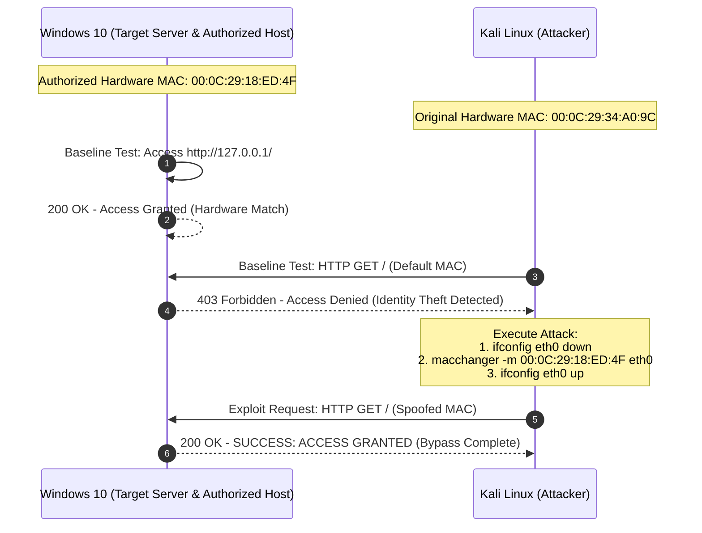
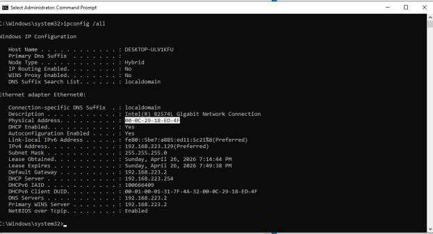
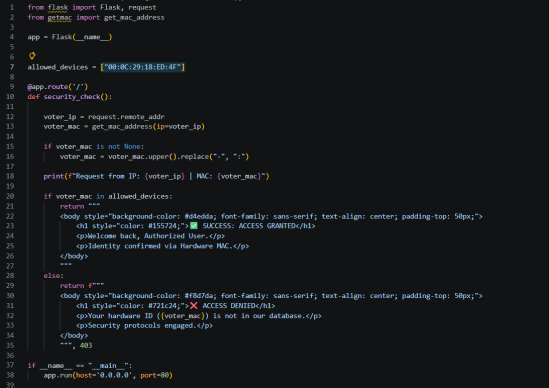
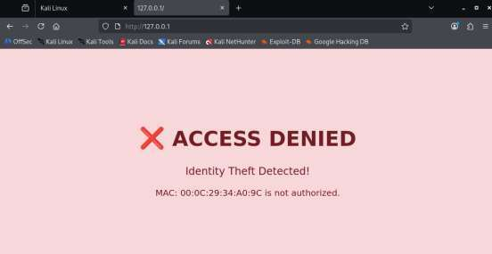
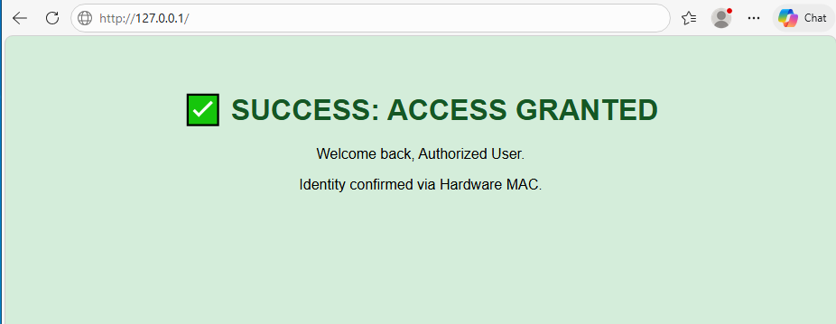
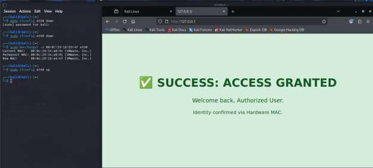

# Layer 2 Authentication Bypass (MAC Spoofing)
### Hardware Identity Spoofing & Layer 2 Access Control Vulnerability Analysis

[](https://github.com/JaserHalabi)
[](https://github.com/JaserHalabi)
[](https://github.com/JaserHalabi)
[](https://attack.mitre.org/techniques/T1036/007/)

---

## 📌 Project Overview

This lab demonstrates how relying solely on **Layer 2 hardware identifiers (MAC addresses)** for authentication and access control creates severe security risks. By deploying a custom Python web service with a hardware-based Access Control List (ACL) on Windows 10 and leveraging Kali Linux penetration testing tools (`macchanger`), this project simulates a real-world Layer 2 identity theft attack and evaluates enterprise-grade defensive mitigations.

### Primary Objectives
- **Identify Flaws in Hardware Filtering**: Show why MAC address filtering provides false security when treated as an authentication boundary.
- **Simulate Adversary Technique**: Replicate hardware identity spoofing using `macchanger` on an isolated VMware virtual network.
- **Evaluate Enterprise Mitigations**: Contrast weak Layer 2 filtering against robust controls including **802.1X Port Authentication**, **Cisco Port Security (Sticky MAC)**, and **Dynamic ARP Inspection (DAI)**.

---

## 🛠️ Lab Environment & Topology

| Role | Operating System | Network Identity | Primary Software / Function |
| :--- | :--- | :--- | :--- |
| **Server / Host** | Windows 10 | `192.168.223.129`<br/>MAC: `00:0C:29:18:ED:4F` | Hosts Flask web service with MAC-based ACL |
| **Attacker Machine** | Kali Linux | Default MAC: `00:0C:29:34:A0:9C`<br/>Spoofed MAC: `00:0C:29:18:ED:4F` | Network discovery, `macchanger`, packet analysis |
| **Hypervisor** | VMware Workstation | Host-Only / NAT Network | Isolated Layer 2 broadcast domain |



---

## 🔬 Step-by-Step Implementation & Proof of Concept

### Step 1: Environment Reconnaissance & Target MAC Discovery
To determine the authorized physical identity on the local subnet, the Windows 10 host network adapter configuration was inspected via `ipconfig /all`.

* **Target Physical Address (MAC)**: `00-0C-29-18-ED-4F`
* **Target IPv4 Address**: `192.168.223.129`



---

### Step 2: Implementation of the Vulnerable Web Service
A custom web application was created using Python, Flask, and the `getmac` library to resolve client hardware addresses from incoming network frames and validate them against a static whitelist:

```python
from flask import Flask, request
from getmac import get_mac_address

app = Flask(__name__)
ALLOWED_DEVICES = ["00:0C:29:18:ED:4F"]

@app.route("/")
def security_check():
    client_ip = request.remote_addr
    client_mac = get_mac_address(ip=client_ip)
    
    if client_mac is not None:
        client_mac = client_mac.upper().replace("-", ":")
        
    if client_mac in ALLOWED_DEVICES:
        return "<h1>✅ SUCCESS: ACCESS GRANTED</h1><p>Identity confirmed via Hardware MAC.</p>"
    else:
        return "<h1>❌ ACCESS DENIED</h1><p>Identity Theft Detected!</p>", 403
```



---

### Step 3: Server-Side Baseline Validation
Navigating to the web service directly from the authorized Windows 10 host confirmed that requests originating from MAC `00:0C:29:18:ED:4F` match the whitelist and are granted access.



---

### Step 4: Baseline Testing from Kali Linux (Access Denied)
Before executing the bypass, a baseline connection was attempted from the Kali Linux virtual machine using its default factory MAC address (`00:0C:29:34:A0:9C`).

Because this address was not present in the application's hardware database, the server rejected the connection and returned an **HTTP 403 Forbidden** response with an *"Identity Theft Detected"* warning.



---

### Step 5: Attack Execution via Macchanger
To bypass the Layer 2 filter, `macchanger` was used on Kali Linux to clone the authorized host's physical address onto network interface `eth0`:

```bash
# 1. Bring down the network interface to allow hardware register modification
sudo ifconfig eth0 down

# 2. Assign the authorized hardware MAC address to the interface
sudo macchanger -m 00:0C:29:18:ED:4F eth0

# 3. Re-enable the interface with the spoofed physical identity
sudo ifconfig eth0 up
```

Upon refreshing the browser, the web application inspected incoming ARP/Ethernet frame data, matched the spoofed MAC against `ALLOWED_DEVICES`, and granted full access:



---

## 🛡️ Enterprise Mitigations & Defensive Architecture

While MAC filtering is often promoted as a basic access control measure, this lab proves it is completely ineffective against anyone with basic network visibility. To protect enterprise networks against MAC spoofing and unauthorized access, the following defenses must be implemented:

### 1. IEEE 802.1X Port-Based Network Access Control (PNAC)
- Instead of relying on easily forged Layer 2 frames, **802.1X** requires devices to authenticate cryptographically (via EAP-TLS, PEAP, or certificates) against an enterprise RADIUS/AAA server before switchports pass any data traffic.

### 2. Cisco Switchport Port Security (Sticky MAC & Violations)
- On managed access layer switches, enable port security with hard limits on learned MAC addresses:
  ```cisco
  Switch(config-if)# switchport mode access
  Switch(config-if)# switchport port-security
  Switch(config-if)# switchport port-security maximum 1
  Switch(config-if)# switchport port-security mac-address sticky
  Switch(config-if)# switchport port-security violation shutdown
  ```
- If an unauthorized device attempts to claim an existing port or change MAC identities, the switch automatically puts the interface into `err-disable` (shutdown).

### 3. Dynamic ARP Inspection (DAI) & DHCP Snooping
- DAI validates ARP packets across the local broadcast domain against a trusted DHCP Snooping binding database. This prevents attackers from poisoning ARP caches or redirecting traffic via spoofed Layer 2 identities.

### 4. Application-Layer Authentication & Mutual TLS (mTLS)
- Access control must never depend on lower-layer unauthenticated headers. Critical applications must enforce session tokens, multi-factor authentication (MFA), or **mTLS client certificates** verified at Layer 7.

---

## 📋 Key Findings & Security Conclusions

1. **MAC Addresses are Not Secrets or Passwords**: Ethernet addresses are transmitted unencrypted in every frame header and can be captured passively with any packet sniffer (Wireshark, tcpdump).
2. **OS-Level Modifiability**: Operating system network drivers allow hardware MAC addresses to be overridden in seconds without specialized hardware.
3. **Defense-in-Depth Required**: Real network security requires cryptographic identity validation (802.1X, PKI) and active switchport security rather than passive hardware filters.

---

## 📂 Repository Structure

```text
├── assets/
│   └── screenshots/
│       ├── 01-target-mac-ipconfig.png
│       ├── 02-vulnerable-flask-script.png
│       ├── 03-authorized-access-granted.png
│       ├── 04-kali-access-denied.png
│       └── 05-macchanger-spoof-success.png
├── src/
│   ├── app.py               # Vulnerable Python web app with MAC ACL filter
│   └── requirements.txt     # Python dependencies (Flask, getmac)
├── .gitignore
└── README.md                # Project documentation and mitigation analysis
```
